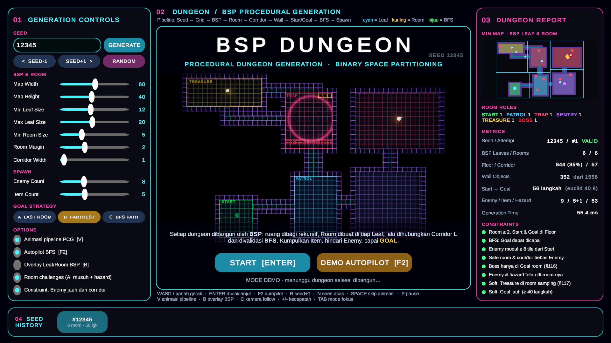
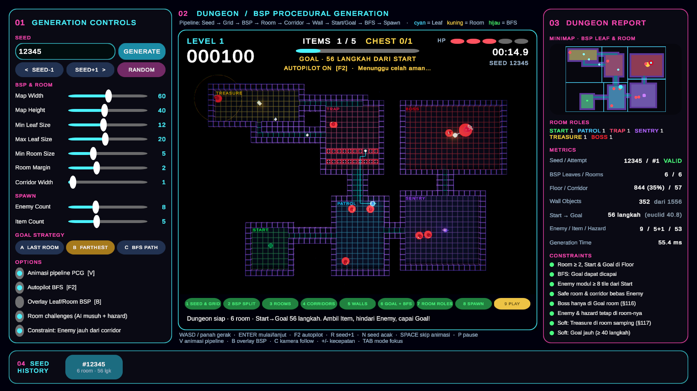
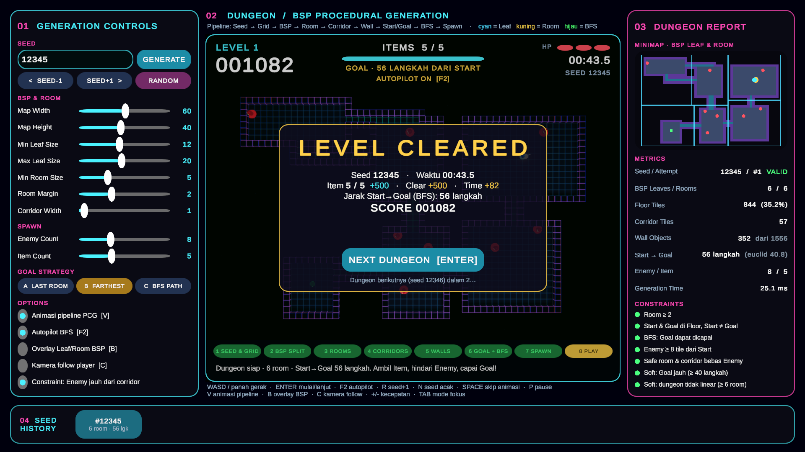
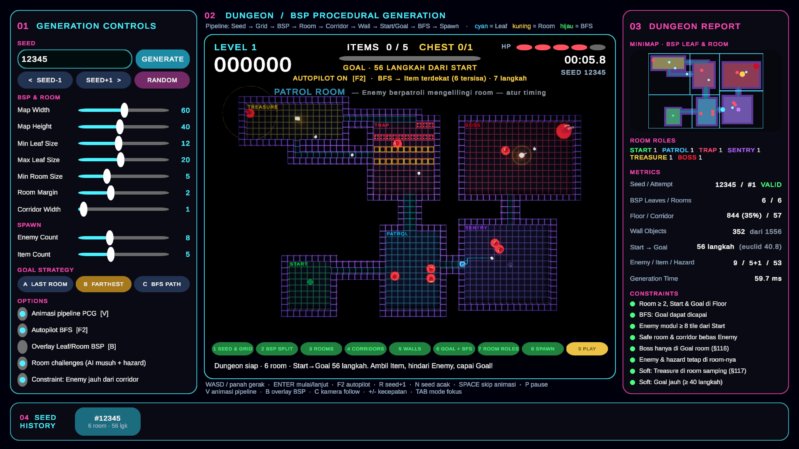
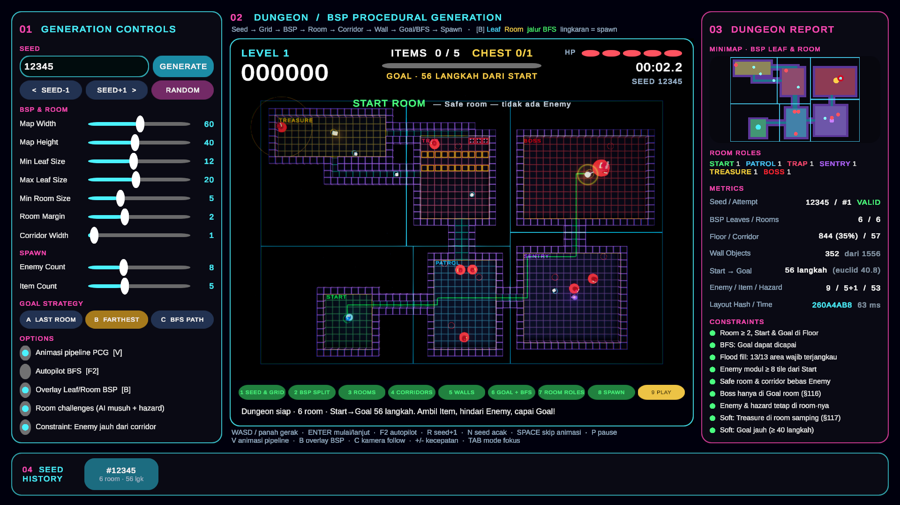
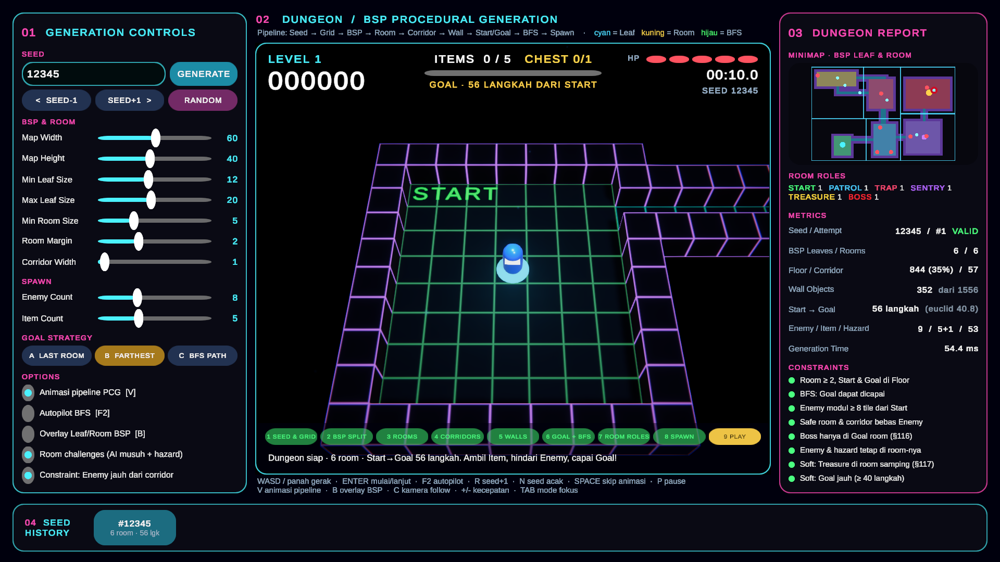

# GameCerdas P10 — Procedural Dungeon Generation dengan BSP

Unity 6 (6000.0.83f1) · URP + post-processing · uGUI/TextMeshPro · Input Manager lama








## Room Challenges — setiap room punya tantangan berbeda
Setelah layout BSP selesai, lapisan PCG kedua (`RoomChallengeSystem`) memberi **peran** pada tiap room:

| Peran | Aturan penempatan | Tantangan |
|---|---|---|
| **START** | room pertama (hard rule) | Safe room, tanpa Enemy |
| **PATROL** | room termudah (difficulty terendah) | Enemy berpatroli mengelilingi sudut room — atur timing |
| **GUARD** | bergilir sesuai difficulty | Penjaga diam dengan **radius deteksi** (lingkaran kuning); masuk radius → dikejar → kembali ke pos bila kehilangan player |
| **TRAP** | bergilir sesuai difficulty | Spike bergelombang per lajur: turun → **peringatan oranye** → naik (damage) |
| **SENTRY** | bergilir, room ≥ 6×6 | Turret membidik & menembak bila ada line of sight, mata berkedip sebelum menembak |
| **TREASURE** | room samping terjauh di luar jalur utama Start→Goal (§117) | Peti harta **+300**, dijaga Guard |
| **BOSS** | room Goal (hard rule, §116) | Boss besar menjaga area Goal |

- **Difficulty** = jarak BFS center room dari Start (0–1). Room dekat Start lebih mudah dan tantangan naik bertahap.
- Assignment memakai `System.Random(seed)` terpisah, sehingga urutan random modul tidak berubah dan seed yang sama tetap menghasilkan dungeon yang identik (tabel eksperimen 1–6 tidak berubah).
- Setiap room diberi warna lantai dan label sesuai perannya, dan banner muncul saat player masuk room.
- **Enemy bergerak dengan FSM** (`EnemyController`): Idle (perilaku SimpleEnemy modul) · Patrol · Wander · Watch → Chase → Return · Boss. Warna mata menunjukkan state (kuning = berjaga, merah berkedip = mengejar). Gerakan dibatasi di dalam room asal, jadi Enemy tidak menembus Wall dan constraint spawn modul tetap berlaku. Setelah menyerang, Enemy mundur sejenak (*recoil*).
- Toggle **Room challenges** di panel kiri mematikan lapisan ini untuk perbandingan dengan perilaku modul dasar (Enemy diam berputar).

## Scene
| Scene | Isi |
|---|---|
| `Assets/Scenes/PCG_Dungeon_Demo.unity` | **Demo autoplay.** Animasi pipeline PCG (termasuk tahap ROOM ROLES) → mulai otomatis → Player berjalan sendiri (autopilot BFS) → Level Cleared → dungeon berikutnya (seed + 1), terus berulang tanpa input. Bila gagal 2× pada seed yang sama, demo pindah ke seed berikutnya. |
| `Assets/Scenes/PCG_Dungeon_Scene.unity` | **Scene praktikum.** Layout dan fitur sama, tetapi dimainkan manual (ENTER untuk mulai, WASD). F2 menyalakan autopilot kapan saja. |

Cara cepat: menu **Tools > GameCerdas P10 > 4. Open DEMO (Autoplay)**. Atur Game view ke 1920×1080 atau 16:9.

## Tampilan Dashboard (gaya Praktikum 9)
| Panel | Isi |
|---|---|
| **01 Generation Controls** (kiri) | Input seed + GENERATE, SEED±1, RANDOM. Slider Map Width/Height, Min/Max Leaf, Min Room, Room Margin, Corridor Width, Enemy/Item Count (dungeon otomatis di-generate ulang). Strategi Goal A/B/C. Toggle animasi pipeline, autopilot, overlay BSP, kamera follow, constraint corridor. |
| **02 Viewport** (tengah) | Dungeon live (RenderTexture) + HUD: level, skor, item bar, jarak Goal, status autopilot, HP, timer, seed. **Pipeline tracker** 8 tahap (Seed & Grid → BSP Split → Rooms → Corridors → Walls → Goal + BFS → Spawn → Play) dengan keterangan langkah yang sedang berjalan. |
| **03 Dungeon Report** (kanan) | **Minimap** (garis Leaf BSP, room, corridor, marker player/enemy/item/goal), metrics (seed, attempt, leaves/rooms, floor %, corridor, wall object, jarak Start→Goal, waktu generate), dan **checklist constraint** (hijau = terpenuhi, merah = hard gagal, kuning = soft gagal). |
| **04 Seed History** (bawah) | 8 seed terakhir; klik untuk me-load ulang (bukti reproducibility). |

Layar di dalam viewport: Title, Level Cleared (rincian skor), Caught/Game Over (retry dengan seed sama), Pause.

## Kontrol
| Tombol | Fungsi |
|---|---|
| WASD / panah | Gerak |
| ENTER | Mulai / dungeon berikutnya / retry |
| F2 | Autopilot BFS on/off |
| R / N | Seed + 1 / seed acak |
| SPACE | Lewati animasi pipeline |
| V / B / C | Animasi pipeline / overlay Leaf-Room BSP / kamera follow |
| + / - | Kecepatan permainan 0.5×–4× |
| P / ESC | Pause |
| TAB | Mode fokus (viewport penuh) |

Aturan main: Item +100, peti harta +300, Goal +500 + bonus waktu. Kena Enemy/spike/proyektil −1 HP (5 HP, pulih +2 setiap level selesai). HP habis → retry dengan seed yang sama.

## Menu Editor (`Tools > GameCerdas P10`)
| Menu | Fungsi |
|---|---|
| 1. Build Assets + Scene | Membuat ulang materials neon, prefabs, post-processing, dan kedua scene |
| 2. Run Experiments | Eksperimen 1–7 + Tugas §126 → `Hasil_Eksperimen_P10.md` |
| 3. Open Scene And Play | Scene praktikum |
| 4. Open DEMO (Autoplay) | Scene demo |

## Struktur
```
Assets/
├── Scenes/      PCG_Dungeon_Scene.unity, PCG_Dungeon_Demo.unity
├── Scripts/
│   ├── PCG/       TileType, DungeonRoom, BSPNode, DungeonGenerator   ← inti modul
│   │              RoomChallengeSystem (room role assignment)
│   ├── Player/    SimplePlayerController
│   ├── Enemy/     SimpleEnemy (modul), EnemyController (FSM)
│   ├── Gameplay/  DungeonGameManager (state, skor, HP, input)
│   │              DungeonDemoDirector (animasi pipeline + autopilot BFS)
│   │              DungeonHUD (dashboard), GoalTrigger, ItemPickup
│   │              Hazards/ SpikeTrap, Turret, Projectile
│   ├── Common/    UIFactory, Fx, AudioManager, PostFxController, ... (dari P09)
│   └── Editor/    DungeonProjectBuilder, DungeonExperimentRunner
├── Prefabs/  Dungeon (Floor, Wall, Goal, Start, Spike, Turret) · Characters (Player, Enemy) · Items (Item, Chest)
├── Materials/  neon: tekstur tepi (T_Edge) sebagai emission map
└── Resources/Fx, Textures, TextMesh Pro, Settings/P10_PostFX.asset
```

## Pipeline Generator (`DungeonGenerator.GenerateDungeon`)
```
ClearDungeon → SetupSeed
→ [Generate-and-Test, maks 10 attempt]
     InitializeGrid (Wall-First) → CreateBSP/SplitNode (rekursif)
     → CreateRooms → CreateCorridors (L-shaped) → PlaceStartAndGoal
     → ValidateDungeon + HasPathToGoal (BFS) → tidak valid? seed++ dan ulangi
→ BuildDungeon (Floor/Corridor, Wall visible saja, Start, Goal)
→ SpawnGameplayObjects (Player; Enemy & Item dengan constraint)
→ RoomChallengeSystem.Build (peran room, hazard, mode FSM Enemy, Boss, peti)
→ Validasi area wajib (flood fill dari Start, memperhitungkan objek solid):
     Goal + setiap room + setiap item + peti harus terjangkau
     → gagal? REPAIR (hapus objek penghalang) → masih gagal? generate ulang (maks. 10×)
→ Metrics + Layout Hash → event Generated (HUD, animasi, game manager)
```

## Checklist Wajib (§125, §128)
Grid ✔ · Seed ✔ · BSP ✔ · Room ✔ · Corridor ✔ · Start ✔ · Goal ✔ · Floor ✔ · Wall ✔ · Player di Start ✔ ·
Enemy hanya di Floor & ≥ 8 tile dari Start ✔ · Item di Floor ✔ · Seed sama → dungeon identik ✔ · Tanpa error Console ✔ · Dapat dimainkan ✔

## Pengembangan yang Diimplementasikan
- **BFS Validation** + **Generate-and-Test** (§93, §119), ditambah **flood fill area wajib + repair** setelah objek di-spawn
- **Layout Hash** di panel report: bukti di layar bahwa seed & parameter sama menghasilkan layout identik
- **Overlay B**: Leaf, Room, jalur BFS Start→Goal, dan lingkaran lokasi spawn
- **Improved Goal Placement**: strategi A (Last Room), B (Farthest Euclidean, default), C (Farthest BFS Path)
- **Runtime Regeneration** + alur level berikutnya
- **Dungeon Metrics** + **checklist constraint** live
- **Constraint tambahan**: safe room tanpa Enemy dan **Enemy tidak menutup corridor**. Tanpa constraint ini, seed 12345 menaruh Enemy di corridor 1 tile yang menjadi satu-satunya jalan keluar Start room, sehingga level tidak bisa diselesaikan.
- **Visualisasi pipeline**: split BSP per kedalaman, room, corridor, wall sweep, jalur BFS, dan spawn
- **Room Challenges** (Boss Room §116, Treasure Room §117, Patrol/Guard/Trap/Sentry) + **Enemy FSM**
- **Autopilot BFS dinamis**: rencana ulang tiap 0,3 s; menghindari Enemy bergerak, radius deteksi Guard, spike aktif/akan aktif, garis tembak proyektil; menunggu celah aman bila perlu
- Enemy density opsional, corridor width 1–3, Gizmos (room, leaf, start, goal)

## Catatan Implementasi
- Kode inti mengikuti modul. Perbaikan yang ditambahkan:
  - Loop `SpawnEnemies` diberi batas percobaan (versi modul bisa infinite loop).
  - Enemy dan Item tidak boleh menumpuk di tile yang sama.
  - Player diperkecil (radius 0.3) agar muat di corridor 1 tile.
  - `ClearDungeon` me-rename object lama sebelum `Destroy()` (§98).
- Input Player memakai `ClampMagnitude` (bukan `normalized`) agar autopilot tidak melewati waypoint pada FPS rendah. Input keyboard tetap sama.
- Experiment Runner memanggil `RunDataOnly()` dengan urutan random yang identik dengan Play Mode.
